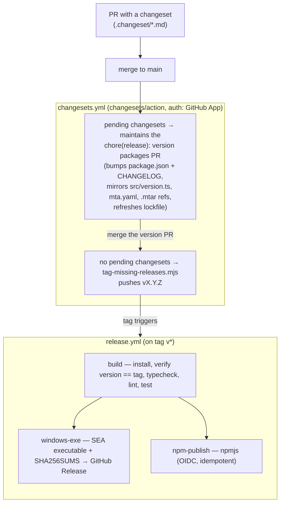

# Release guide (maintainers)

ADAM ships **one release per version, multi-artifact**: a single tag `vX.Y.Z`
produces the npm package (`@adam-mcp/server` on npmjs, via Trusted Publishing)
and the GitHub Release with the Windows executable and its checksum. Releases are driven by
[Changesets](https://github.com/changesets/changesets), the same mechanism as
[`ClementRingot/ROSA`](https://github.com/ClementRingot/ROSA).

- [Pipeline overview](#pipeline-overview)
- [The normal flow](#the-normal-flow)
- [The changeset guard](#the-changeset-guard)
- [Dependabot](#dependabot)
- [What the release workflow does](#what-the-release-workflow-does)
- [One-time setup (bootstrap)](#one-time-setup-bootstrap)
- [Manual fallback](#manual-fallback)
- [If a job fails mid-release](#if-a-job-fails-mid-release)

## Pipeline overview



## The normal flow

A release is **a changeset plus two PR merges, no local release commands.**

1. Every PR that changes shipped code includes a **changeset** (`npx changeset`)
   describing the change and its bump level (patch/minor/major). The
   [`guard`](#the-changeset-guard) CI check enforces this.
2. On each push to `main`, [`changesets.yml`](../.github/workflows/changesets.yml)
   runs [`changesets/action`](https://github.com/changesets/action):
   - **pending changesets** → it opens/updates a **`chore(release): version
     packages`** PR that runs `npm run changeset:version`: bumps `package.json`,
     writes `CHANGELOG.md`, then [`scripts/sync-version.mjs`](../scripts/sync-version.mjs)
     mirrors the version into `src/version.ts` (what `--version`, `/health` and the
     MCP handshake report), `mta.yaml` and every `_X.Y.Z.mtar` reference, and
     `package-lock.json` is refreshed.
   - **no pending changesets** (right after that PR merges) → it runs
     [`scripts/tag-missing-releases.mjs`](../scripts/tag-missing-releases.mjs),
     which pushes the canonical **`vX.Y.Z`** tag for the committed version.
3. The pushed tag triggers [`release.yml`](../.github/workflows/release.yml).

So the only human steps are **merging the PR** and **merging the version PR**.

> **Auth: a GitHub App, not a PAT.** A tag pushed with the default `GITHUB_TOKEN`
> does not trigger other workflows (GitHub anti-recursion), so the Changesets
> workflow authenticates as a **GitHub App** whose token *does* trigger
> `release.yml` — and never expires. Set the repo **variable** `RELEASE_APP_ID`
> and **secret** `RELEASE_APP_PRIVATE_KEY` (see [bootstrap](#one-time-setup-bootstrap)).
> While `RELEASE_APP_ID` is unset it falls back to `github.token`: the version PR
> still works, but a tag it pushes won't trigger `release.yml` — start it by hand
> then (Actions → Release → Run workflow, with the tag).

## The changeset guard

A PR that changes what ADAM **ships** must carry a changeset, so a version bump
can never be silently forgotten — most often a Dependabot dependency bump.
[`scripts/require-changeset.mjs`](../scripts/require-changeset.mjs) runs on every
PR (the `guard` job in [`ci.yml`](../.github/workflows/ci.yml)); `npm run
changeset:check` runs it locally against `origin/main`.

**Shipped** = files under `src/**`, `scripts/prepare.mjs`, `scripts/build-exe.mjs`,
`mta.yaml`, `xs-security.json`, runtime dependency ranges in `package.json`, or
any version change in the production closure of `package-lock.json` (helpers +
tests in [`scripts/lib/shipped-deps.mjs`](../scripts/lib/shipped-deps.mjs)).

- Add a changeset: `npx changeset` (pick the bump level).
- **Escape hatch:** to merge a shipped change *without* releasing it, add an
  **empty** changeset: `npx changeset add --empty`. The guard passes with a note.
- A version PR (it deletes the changesets it consumed) passes without a new one.

## Dependabot

[`.github/dependabot.yml`](../.github/dependabot.yml) opens PRs every Monday:

- **npm** — minor and patch updates grouped into one PR (`chore(deps)` for
  runtime, `chore(dev-deps)` for dev dependencies); majors one PR each.
  `@types/node` majors are ignored: it follows `engines.node` (Node 22).
- **GitHub Actions** — all action updates grouped (`chore(ci)`).

A Dependabot PR that changes the runtime closure fails the guard until a
changeset is added to its branch (`npx changeset`, usually a patch, or an empty
one) — the deliberate trade-off that stops a dependency bump from shipping
unreleased. Dev-only and Actions bumps pass as they are.

## What the release workflow does

`release.yml` (trigger: tags `v*`, or by hand with a tag) has three jobs:

1. **build** (gate) — `npm ci`, build, **fail unless the tag, `package.json` and
   `dist/index.js --version` agree**, then typecheck, lint, test. Nothing is
   published unless this passes.
2. **windows-exe** — builds the single executable on Windows (Node 24 SEA),
   writes `SHA256SUMS.txt`, creates the GitHub Release with generated notes if
   missing, and uploads both (overwriting on a re-run).
3. **npm-publish** — publishes `@adam-mcp/server` to **npmjs** via **Trusted Publishing (OIDC)** —
   no token; provenance attached. **Idempotent:** skipped if that version is
   already on npm.

## One-time setup (bootstrap)

### 1. Release GitHub App

Reuse the App that serves ROSA (or create one: Settings → Developer settings →
GitHub Apps, **Contents: RW** and **Pull requests: RW**, no webhook) and
**install it on this repository**. Then set the repo **variable**
`RELEASE_APP_ID` (numeric App ID) and **secret** `RELEASE_APP_PRIVATE_KEY` (a
generated `.pem`). No PAT, nothing to rotate.

Also allow Actions to open PRs: Settings → Actions → General → *Allow GitHub
Actions to create and approve pull requests* (needed for the `github.token`
fallback only).

### 2. First npm publish + Trusted Publisher

npmjs can only configure a Trusted Publisher for a package that **already
exists**, so the first publish uses a token. `release.yml` carries a
**temporary** `NODE_AUTH_TOKEN: ${{ secrets.NPM_TOKEN }}` on its publish step
for that. The package lives in the npm organization **`adam-mcp`** (as ROSA's
in `rosa-mcp`), which must exist, and the token must be allowed to publish to it.

1. Create a short-lived **granular access token** on npmjs.com (read and write,
   bypass 2FA) and save it as the repo **secret** `NPM_TOKEN` (Settings → Secrets
   and variables → Actions).
2. Let the first release run (the `v0.1.0` tag pushed after the merge, or Actions
   → Release → Run workflow with the tag): `npm-publish` publishes with the token.
3. On npmjs.com → the package → **Settings → Trusted Publisher** → add a
   **GitHub Actions** publisher: repository `ClementRingot/ADAM`, workflow
   `release.yml`.
4. Back to OIDC only: delete the `NPM_TOKEN` secret, the token on npmjs.com, and
   the `env:` block (with its comment) from the publish step of `release.yml`.

Equivalent by hand: `npm publish --access public` from a clone with the token,
then steps 3 and 4.

## Manual fallback

If the App isn't configured (or to cut a release by hand):

```bash
npm run changeset:version    # applies pending changesets: bump + CHANGELOG + mirrors
git commit -am "chore(release): version packages" && git push
git tag -a v$(node -p "require('./package.json').version") -m "vX.Y.Z"
git push origin --tags       # pushing as your user triggers release.yml
```

If a tag was created by the workflow's `github.token` fallback and didn't trigger
`release.yml`, run the workflow by hand with that tag, or re-push it locally.

## If a job fails mid-release

The jobs are independent after the `build` gate. **Re-run the failed job** from
the Actions run, or run the workflow by hand with the tag:

- **windows-exe** overwrites the release assets (`--clobber`).
- **npm-publish** is idempotent — it skips publish if the version is on npm.
- **Wrong version tagged** — delete the tag and Release, fix, and re-tag:
  ```bash
  git push --delete origin vX.Y.Z
  ```
